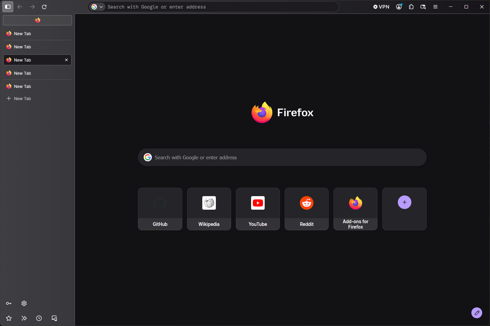
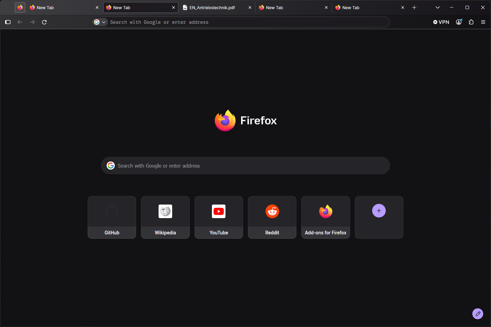
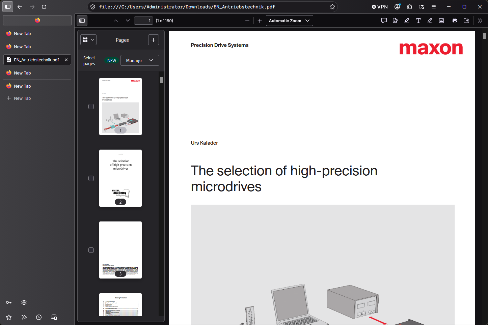
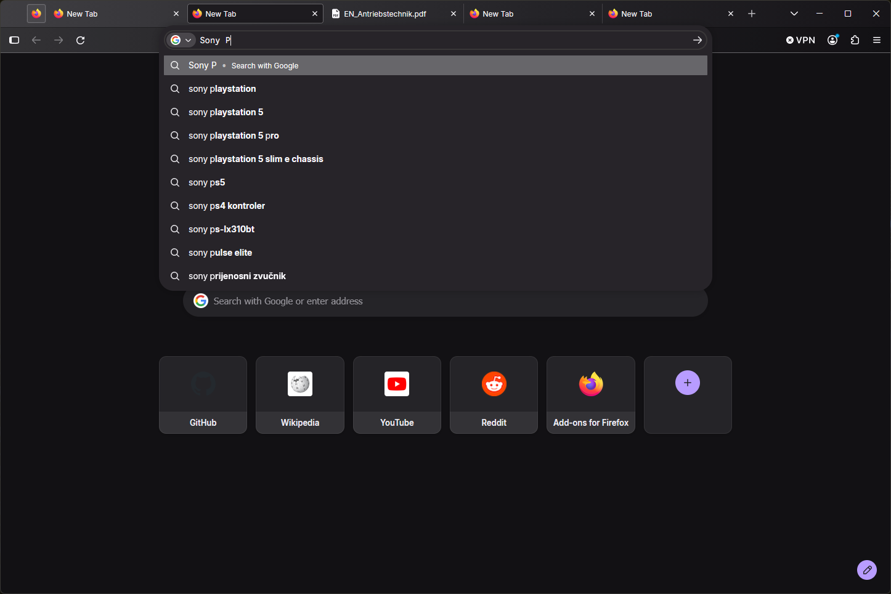

# Planus

Planus is a custom CSS theme for Firefox’s interface, tabs, tab previews and New Tab page, with flatter controls and consistent spacing.

## Screenshots

| Vertical tabs and New Tab | Horizontal tabs and New Tab |
| --- | --- |
|  |  |

| PDF viewer | Address-bar suggestions |
| --- | --- |
|  |  |

## Fonts

Install these fonts before starting Firefox:

- [Inter](https://rsms.me/inter/download/) — browser interface and New Tab labels. Use the regular **Inter** family; the variable version rendered differently on the original setup.
- [Google Sans Code](https://github.com/googlefonts/googlesans-code) — address bar and tab-preview link. Install the variable font; the theme uses its monospace setting.

On Windows, open the downloaded font files and select **Install**. Restart Firefox after installing them.

## Adaptive Tab Bar Colour

Planus is compatible with [Adaptive Tab Bar Colour](https://addons.mozilla.org/en-GB/firefox/addon/adaptive-tab-bar-colour/), which adjusts Firefox’s colours to match the active website. Planus uses Firefox’s standard theme colour variables so the extension can colour the browser interface.

The theme includes 0.5-second transitions for background colours, borders and outlines across the toolbars, sidebar and address bar. Tab selection and hover feedback keep their faster timing. These transitions respect the reduced-motion preference. The extension is optional and installed separately.

## Installation

1. Open `about:config` and set `toolkit.legacyUserProfileCustomizations.stylesheets` to `true`.
2. Open `about:support` and select **Open Folder** beside **Profile Folder**.
3. Quit Firefox completely. Create a folder named `chrome` inside the profile folder if needed.
4. Copy the theme’s `userChrome.css` and `userContent.css` into that `chrome` folder:

   ```text
   Firefox profile/
   └── chrome/
       ├── userChrome.css
       └── userContent.css
   ```

5. Start Firefox. Restart it after editing either stylesheet.

Back up existing files with the same names before replacing them; merge the rules if you use other customizations.

Firefox updates can change the interface and break custom CSS. To disable the theme, set the preference in step 1 to `false` and restart Firefox.
